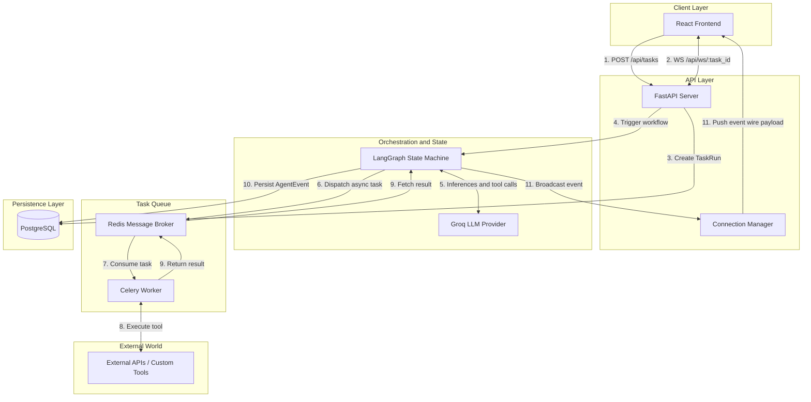
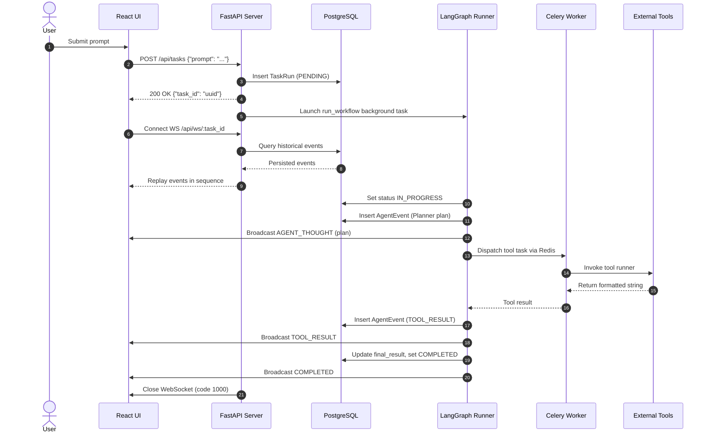

# Multi-Agent AI Orchestration System

A stateful multi-agent system that executes complex, multi-step tasks using specialized agents and custom tools. Built with LangGraph, FastAPI, Celery, Redis, PostgreSQL and React. Provides real-time execution visibility and complete database auditability over WebSockets.

---

## Architecture

The system follows an asynchronous, event-driven pattern designed for long-running reasoning and tool executions.

### Flowchart



### Sequence Diagram



---

## Technology Stack

| Component | Technology | Version | Description |
|---|---|---|---|
| API Framework | FastAPI | 0.143.0 | REST endpoints and WebSocket server |
| ASGI Server | Uvicorn | 0.54.0 | ASGI runtime |
| Orchestration Engine | LangGraph | 1.2.15 | Cyclic state machine for multi-agent workflows |
| LLM Integration | langchain-groq | 1.1.3 | Groq model provider integration |
| Database ORM | SQLAlchemy | 2.1.4 | Asynchronous database operations |
| Migrations | Alembic | 1.20.0 | Database schema versioning |
| Primary Database | PostgreSQL | 16-alpine | Relational audit persistence |
| Task Queue Broker | Redis | 7-alpine | Celery message broker and result backend |
| Distributed Queue | Celery | 5.6.3 | Asynchronous tool execution |
| Frontend Library | React | 18.3.1 | User interface with live timeline |
| Build Tool | Vite | 8.3.4 | Development server and production bundler |
| Type System | TypeScript | 5.9.3 | Strict static type checking |
| Web Server | Nginx | 1.27-alpine | Nginx 1.27 static file server |

---

## Repository Layout

```
.
├── .env.example
├── .gitignore
├── docker-compose.yml
├── README.md
├── EVALUATION.md
├── backend/
│   ├── alembic.ini
│   ├── Dockerfile
│   ├── .dockerignore
│   ├── pyproject.toml
│   ├── requirements.txt
│   ├── requirements-dev.txt
│   ├── app/
│   │   ├── main.py
│   │   ├── api/
│   │   │   ├── tasks.py
│   │   │   ├── websocket.py
│   │   │   ├── connection_manager.py
│   │   │   └── health.py
│   │   ├── agents/
│   │   │   ├── graph.py
│   │   │   ├── runner.py
│   │   │   ├── state.py
│   │   │   ├── prompts.py
│   │   │   ├── llm.py
│   │   │   ├── events.py
│   │   │   ├── tool_executor.py
│   │   │   └── nodes/
│   │   │       ├── planner.py
│   │   │       ├── researcher.py
│   │   │       └── synthesizer.py
│   │   ├── core/
│   │   │   ├── config.py
│   │   │   └── enums.py
│   │   ├── db/
│   │   │   ├── base.py
│   │   │   ├── session.py
│   │   │   ├── models.py
│   │   │   ├── repositories.py
│   │   │   └── migrations/
│   │   │       ├── env.py
│   │   │       └── versions/
│   │   ├── tools/
│   │   │   ├── schemas.py
│   │   │   ├── registry.py
│   │   │   ├── web_search.py
│   │   │   ├── weather.py
│   │   │   └── calculator.py
│   │   └── worker/
│   │       ├── celery_app.py
│   │       └── tasks.py
│   └── tests/
│       ├── conftest.py
│       ├── test_agents_orchestration.py
│       ├── test_api_health.py
│       ├── test_api_tasks_and_ws.py
│       ├── test_db_repositories.py
│       ├── test_docs_consistency.py
│       ├── test_graph_flow.py
│       ├── test_lifespan.py
│       ├── test_llm_retry.py
│       ├── test_runner.py
│       ├── test_tool_executor.py
│       ├── test_tools_calculator.py
│       ├── test_tools_celery.py
│       ├── test_tools_weather.py
│       ├── test_tools_web_search.py
│       ├── test_ws_live.py
│       └── test_ws_race.py
├── frontend/
│   ├── Dockerfile
│   ├── .dockerignore
│   ├── nginx.conf
│   ├── index.html
│   ├── package.json
│   ├── tsconfig.json
│   ├── tsconfig.node.json
│   ├── vite.config.ts
│   └── src/
│       ├── main.tsx
│       ├── App.tsx
│       ├── App.test.tsx
│       ├── types.ts
│       ├── styles.css
│       ├── api/
│       │   └── client.ts
│       ├── hooks/
│       │   ├── useAgentWebSocket.ts
│       │   └── useAgentWebSocket.test.ts
│       ├── components/
│       │   ├── TaskForm.tsx
│       │   ├── TaskForm.test.tsx
│       │   ├── Timeline.tsx
│       │   ├── Timeline.test.tsx
│       │   ├── EventCard.tsx
│       │   ├── EventCard.test.tsx
│       │   ├── PlanPanel.tsx
│       │   ├── PlanPanel.test.tsx
│       │   ├── ConnectionBadge.tsx
│       │   ├── FinalResult.tsx
│       │   └── FinalResult.test.tsx
│       └── test/
│           └── setup.ts
└── scripts/
    └── watch_task.py
```

---

## Quick Start

### Prerequisites

- Docker 24+ and Docker Compose v2+
- Python 3.12+ (for local CLI utilities; install dependencies with `pip install requests websockets` before using `scripts/watch_task.py`)
- Groq API Key (from console.groq.com)
- OpenWeather API Key (from openweathermap.org)

### Setup and Running with Docker Compose

1. Copy the example environment file:
   ```bash
   cp .env.example .env
   ```
2. Set your API credentials in `.env`:
   - `LLM_API_KEY`: your Groq API key
   - `OPENWEATHER_API_KEY`: your OpenWeather API key
3. Build and launch all five services:
   ```bash
   docker compose up --build
   ```
4. Confirm all five services report healthy status:
   ```bash
   docker compose ps
   ```
   Expected status output when all five services are healthy:
   ```text
   NAME                  IMAGE                                      STATUS
   orchestrator-api      rushi5706/multi-agent-orchestrator:backend Up (healthy)
   orchestrator-db       postgres:16-alpine                         Up (healthy)
   orchestrator-redis    redis:7-alpine                             Up (healthy)
   orchestrator-ui       rushi5706/multi-agent-orchestrator:ui      Up (healthy)
   orchestrator-worker   rushi5706/multi-agent-orchestrator:backend Up (healthy)
   ```
5. Access the services:
   - Frontend UI: `http://localhost:3000`
   - FastAPI Interactive Docs: `http://localhost:8000/docs`
   - Healthcheck Endpoint: `http://localhost:8000/health`

---

## Configuration Reference

The following environment variables configure the application:

| Variable | Default Value | Description |
|---|---|---|
| `DATABASE_URL` | none (required) | PostgreSQL async connection string (`postgresql+asyncpg://...`) |
| `POSTGRES_USER` | `postgres` | PostgreSQL username |
| `POSTGRES_PASSWORD` | `postgres` | PostgreSQL password |
| `POSTGRES_DB` | `orchestrator` | PostgreSQL database name |
| `REDIS_URL` | none (required) | Redis connection URL for Celery broker and results |
| `LLM_API_KEY` | none (required) | Groq API key |
| `LLM_MODEL` | `qwen/qwen3.8-27b` | Groq model identifier |
| `LLM_TEMPERATURE` | `0.1` | Sampling temperature for model inferences |
| `LLM_MAX_RETRIES` | `3` | Maximum retry attempts for transient model errors |
| `OPENWEATHER_API_KEY` | empty | OpenWeather API key used by the `get_weather` tool |
| `CORS_ORIGINS` | `http://localhost:3000,http://127.0.0.1:3000` | Comma-separated allowed origins |
| `MAX_PLAN_STEPS` | `5` | Upper limit on steps produced by the Planner |
| `MAX_TOOL_ITERATIONS` | `4` | Maximum tool-call cycles allowed per research step |
| `MAX_TOOL_OUTPUT_CHARS` | `1500` | Maximum characters permitted before output truncation |
| `TOOL_TIMEOUT_SECONDS` | `45` | Timeout limit for Celery tool task execution |
| `WORKFLOW_TIMEOUT_SECONDS` | `300` | Maximum workflow execution time before timing out |
| `TOOL_SIMULATED_DELAY_SECONDS` | `0` | Artificial sleep delay in Celery tools for testing |
| `WS_HEARTBEAT_SECONDS` | `15` | Interval for heartbeat frames on idle WebSocket connections |
| `LOG_LEVEL` | `INFO` | Application log level (`DEBUG`, `INFO`, `WARNING`, `ERROR`) |

---

## API Reference

### REST Endpoints

#### 1. Initiate Task

- **POST** `/api/tasks`
- **Request Body**:
  ```json
  {
    "prompt": "What is the current weather in Tokyo, and based on that, what should I pack?"
  }
  ```
- **Response** (HTTP 200):
  ```json
  {
    "task_id": "7c82a536-e054-4bd5-94be-d731835eec06"
  }
  ```
- **Description**: Creates a new `TaskRun` record in PostgreSQL, schedules the background workflow task, and returns the unique `task_id` immediately.

#### 2. Get Task Audit Record

- **GET** `/api/tasks/{task_id}`
- **Response** (HTTP 200):
  ```json
  {
    "id": "7c82a536-e054-4bd5-94be-d731835eec06",
    "prompt": "What is the current weather in Tokyo, and based on that, what should I pack?",
    "status": "COMPLETED",
    "final_result": "In Tokyo, current temperatures are...",
    "created_at": "2026-10-14T10:00:00.000Z",
    "updated_at": "2026-10-14T10:00:15.000Z",
    "completed_at": "2026-10-14T10:00:15.000Z",
    "events": [...]
  }
  ```
- **Errors**: Returns 404 for unknown task IDs, 422 for malformed UUID strings.

#### 3. Health Check

- **GET** `/health`
- **Response** (HTTP 200):
  ```json
  {
    "status": "ok",
    "database": "up",
    "redis": "up"
  }
  ```
- **Errors**: Returns 503 if either PostgreSQL or Redis is unreachable.

### WebSocket Endpoint

- **WS** `/api/ws/{task_id}`
- **Protocol**: WebSockets over HTTP/HTTPS
- **Behavior**:
  1. On connection, verifies task existence (closes with code 4404 if not found).
  2. Replays all existing `AgentEvent` records in sequence order.
  3. Streams live events as state transitions and tool calls occur.
  4. Emits `HEARTBEAT` messages every `WS_HEARTBEAT_SECONDS` during idle periods.
  5. Closes cleanly with code 1000 after delivering terminal events (`COMPLETED` or fatal `ERROR`).

#### Event Wire Format

Every event delivered over WebSocket uses this structure:

```json
{
  "event_id": "d0ef635b-c2e3-4d43-bb92-c4eec031945c",
  "sequence": 3,
  "task_id": "7c82a536-e054-4bd5-94be-d731835eec06",
  "event_type": "TOOL_INVOCATION",
  "agent": "tool_executor",
  "message": "Invoking tool 'get_weather'",
  "payload": {
    "tool": "get_weather",
    "arguments": {
      "location": "Tokyo, JP",
      "units": "metric"
    },
    "execution": "celery"
  },
  "timestamp": "2026-10-14T10:00:04.123Z"
}
```

### CLI Watch Tool Example

A standalone script is provided to initiate and monitor a workflow from the command line:

```bash
python3 scripts/watch_task.py "What is the current weather in Tokyo, and based on that, what should I pack?"
```

---

## Agents and Tools

### Specialized Agents

| Agent | Responsibility | Tools Permitted |
|---|---|---|
| **Planner** | Decomposes prompt into 1 to 5 ordered research steps | None |
| **Researcher** | Executes individual plan steps via bounded tool loop | `web_search`, `get_weather`, `data_calculator` |
| **Synthesizer** | Combines accumulated findings into final synthesized response | None |

### Custom Tools

| Tool Name | Dispatch Mode | Primary Purpose |
|---|---|---|
| `web_search` | Celery task (`tools.web_search`) | DuckDuckGo search for current news and general facts |
| `get_weather` | Celery task (`tools.get_weather`) | OpenWeather geocoding and weather observations |
| `data_calculator` | Inline execution | AST-safe arithmetic evaluation and summary statistics |

---

## Database Schema

### Table: `task_runs`

| Column | Type | Constraints | Description |
|---|---|---|---|
| `id` | `UUID` | Primary Key | Unique workflow execution identifier |
| `prompt` | `TEXT` | NOT NULL | Original user task prompt |
| `status` | `VARCHAR(32)` | NOT NULL, DEFAULT `'PENDING'` | Lifecycle status (`PENDING`, `IN_PROGRESS`, `COMPLETED`, `FAILED`) |
| `final_result` | `TEXT` | NULLABLE | Synthesized final answer produced by the workflow |
| `created_at` | `TIMESTAMP WITH TIME ZONE` | NOT NULL | Creation timestamp (UTC) |
| `updated_at` | `TIMESTAMP WITH TIME ZONE` | NOT NULL | Last update timestamp (UTC) |
| `completed_at` | `TIMESTAMP WITH TIME ZONE` | NULLABLE | Completion or failure timestamp (UTC) |

### Table: `agent_events`

| Column | Type | Constraints | Description |
|---|---|---|---|
| `id` | `UUID` | Primary Key | Unique event record identifier |
| `task_run_id` | `UUID` | Foreign Key (`task_runs.id`), ON DELETE CASCADE | Associated workflow identifier |
| `sequence` | `INTEGER` | NOT NULL, UNIQUE (`task_run_id`, `sequence`) | Monotonically increasing sequence per task |
| `agent_name` | `VARCHAR(64)` | NOT NULL | Active agent or subsystem emitting the event |
| `event_type` | `VARCHAR(32)` | NOT NULL | Categorized event type (`AGENT_THOUGHT`, `TOOL_INVOCATION`, etc.) |
| `payload` | `JSONB` / `JSON` | NOT NULL | Structured payload containing parameters, results or plan details |
| `timestamp` | `TIMESTAMP WITH TIME ZONE` | NOT NULL | Event creation timestamp (UTC) |

---

## Testing

### Backend Test Suite

Run the complete backend test suite:

```bash
cd backend
source .venv/bin/activate
pytest tests/ -v
```

Run code formatting and lint checks:

```bash
ruff check backend
ruff format --check backend
```

### Frontend Test Suite

Run Vitest unit tests:

```bash
cd frontend
npm test -- --run
```

Run TypeScript compilation and static verification:

```bash
cd frontend
npx tsc --noEmit
npm run build
```

---

## Verifying the Task Validation Scenarios

The system can be validated against the three core requirements using the following procedures:

### 1. Tool Failure and Error Recovery

To verify that third-party tool failures return descriptive errors rather than crashing the workflow:

1. Temporarily configure an invalid OpenWeather API key:
   ```bash
   sed -i '' 's/^OPENWEATHER_API_KEY=.*/OPENWEATHER_API_KEY=invalid_key/' .env
   docker compose restart api worker
   ```
2. Initiate a weather prompt:
   ```bash
   python3 scripts/watch_task.py "What is the current weather in Tokyo, JP?"
   ```
3. Inspect the live timeline:
   The `get_weather` tool invocation returns a formatted `TOOL_RESULT` with `is_error=true` and message `Error: OpenWeather API key rejected (HTTP 401).`
   The Researcher receives this error observation, gracefully informs the Synthesizer that real-time weather data is unavailable, and the workflow reaches `COMPLETED` status.
4. Restore your valid API key in `.env` and restart:
   ```bash
   docker compose restart api worker
   ```

### 2. Database Inspection

All workflow executions and agent events are persisted in PostgreSQL. To inspect historical tool invocations, arguments, and execution outputs directly from the database:

```bash
docker compose exec db sh -c 'psql -U "$POSTGRES_USER" -d "$POSTGRES_DB" -c "
SELECT sequence, agent_name, event_type,
       payload->>\x27tool\x27 AS tool,
       payload->\x27arguments\x27 AS arguments,
       LEFT(payload->>\x27result\x27, 80) AS result_preview
FROM agent_events
WHERE event_type IN (\x27TOOL_INVOCATION\x27, \x27TOOL_RESULT\x27)
ORDER BY sequence ASC;
"'
```

This query confirms:
- Ordered integer sequence continuity per task.
- Tool arguments passed to Celery and inline runners.
- Formatted tool result strings, execution durations, and error flags.

### 3. Non-Blocking Execution with Simulated Delay

To verify that long-running tool execution does not block the FastAPI server or starve healthcheck probes:

1. Configure a 10-second artificial delay in `.env`:
   ```bash
   sed -i '' 's/^TOOL_SIMULATED_DELAY_SECONDS=.*/TOOL_SIMULATED_DELAY_SECONDS=10/' .env
   docker compose restart api worker
   ```
2. In one terminal, initiate a workflow:
   ```bash
   python3 scripts/watch_task.py "What is the current weather in Tokyo, JP?"
   ```
3. While the Celery tool execution is in progress, poll the healthcheck endpoint:
   ```bash
   while true; do curl -s http://localhost:8000/health; echo ""; sleep 1; done
   ```
   All health requests return HTTP 200 with `{"status":"ok","database":"up","redis":"up"}` immediately, and WebSocket connections receive periodic `HEARTBEAT` events without connection timeouts.
4. Reset `TOOL_SIMULATED_DELAY_SECONDS=0` in `.env` and restart services.

---

## Troubleshooting

### WebSocket Connections Dropping

- **Heartbeat Timeout**: The backend emits a `HEARTBEAT` event every `WS_HEARTBEAT_SECONDS` (default: 15s) of inactivity. Ensure intermediate proxies or load balancers do not terminate idle WebSockets under 30 seconds.
- **Client Reconnection**: The React frontend (`useAgentWebSocket`) implements automatic reconnect with exponential backoff. If a connection drops, it re-queries historical events to prevent sequence gaps.

### Celery Worker Not Processing Tasks

- **Redis URL Synchronization**: Ensure the `REDIS_URL` in `.env` is accessible by both the `api` and `worker` containers (`redis://redis:6379/0` within Docker Compose).
- **Inspect Worker Logs**: Check worker availability and queue binding:
  ```bash
  docker compose logs worker -f
  ```
- **Worker Healthcheck**: Verify Celery inspect status:
  ```bash
  docker compose exec worker celery -A app.worker.celery_app inspect ping -d celery@$(hostname) -t 10
  ```

### Groq Model Rate Limits

- **Rate Limit Backoff**: Groq free-tier rate limits (requests and tokens per minute) return HTTP 429. The application parses the `retry-after` header and provider message, waiting up to 60 seconds before retrying.
- **UI Visibility**: While waiting for a rate limit window to reset, a non-fatal `system` action event (`rate_limit_wait`) is emitted to inform the user in real time.

---

## Design Notes and Limitations

- **Single Process API Runtime**: The WebSocket `ConnectionManager` maintains in-process subscription sets for real-time broadcasting. The API container runs a single Uvicorn process. Scaling horizontally across multiple nodes would require a Redis Pub/Sub adapter for cross-process WebSocket fanout.
- **Bounded Step Context**: To avoid context window explosion in multi-step plans, the Researcher agent receives findings from previous steps capped at 1800 characters. Oldest findings are trimmed first if the budget is exceeded.
- **External Search Provider Quotas**: DuckDuckGo search queries may encounter rate limit responses. When this occurs, the tool returns a descriptive error string rather than terminating the workflow, enabling the agent to adapt its query or proceed with partial information.
- **Weather API Coverage**: The `get_weather` tool uses OpenWeather Current Weather 2.5 endpoints. Free-tier accounts require standard city and country specifications (e.g., `"Tokyo, JP"`).

---

## Example Run

The following real execution sequence was captured during live workflow verification for the prompt:
`"What is the current weather in Tokyo, and based on that, what should I pack?"`

Task ID: `ad8cea4c-292b-4568-ba4e-4122ccae6173` | Status: `COMPLETED`

| Sequence | Agent | Event Type | Message |
|---|---|---|---|
| 1 | Planner | AGENT_THOUGHT | Created plan with 2 step(s). |
| 2 | planner | AGENT_ACTION | Node 'planner' completed. |
| 3 | Researcher | AGENT_ACTION | Starting step 1/2: Use the get_weather tool to retrieve the current weather conditions for Tokyo, JP. |
| 4 | tool_executor | TOOL_INVOCATION | Invoking tool 'get_weather' |
| 5 | tool_executor | TOOL_RESULT | Tool 'get_weather' completed in 445ms |
| 6 | Researcher | AGENT_THOUGHT | Current weather in Tokyo, JP (retrieved via get_weather, metric units): Condition: moderate rain, Temp: 20.78C |
| 7 | Researcher | AGENT_THOUGHT | Completed step 1: Current weather in Tokyo, JP (retrieved via get_weather, metric units) |
| 8 | researcher | AGENT_ACTION | Node 'researcher' completed. |
| 9 | Researcher | AGENT_ACTION | Starting step 2/2: Using the temperature and weather conditions found in step 1, search the web for recommendations on what to pack for Tokyo. |
| 10 | Researcher | AGENT_THOUGHT | I'll search for clothing and packing recommendations for Tokyo in these conditions: moderate rain and ~21C. |
| 11 | tool_executor | TOOL_INVOCATION | Invoking tool 'web_search' |
| 12 | tool_executor | TOOL_RESULT | Tool 'web_search' completed in 3638ms |
| 13 | tool_executor | TOOL_INVOCATION | Invoking tool 'web_search' |
| 14 | tool_executor | TOOL_RESULT | Tool 'web_search' completed in 5341ms |
| 15 | system | AGENT_ACTION | Rate limit reached; waiting 2s before retry. |
| 16 | Researcher | AGENT_THOUGHT | Those queries were too generic. Let me search with more specific terms. |
| 17 | tool_executor | TOOL_INVOCATION | Invoking tool 'web_search' |
| 18 | tool_executor | TOOL_RESULT | Tool 'web_search' completed in 2562ms |
| 19 | tool_executor | TOOL_INVOCATION | Invoking tool 'web_search' |
| 20 | tool_executor | TOOL_RESULT | Tool 'web_search' completed in 4964ms |
| 21 | system | AGENT_ACTION | Rate limit reached; waiting 16s before retry. |
| 22 | Researcher | AGENT_THOUGHT | Let me try more specific search queries. |
| 23 | tool_executor | TOOL_INVOCATION | Invoking tool 'web_search' |
| 24 | tool_executor | TOOL_RESULT | Tool 'web_search' completed in 4928ms |
| 25 | tool_executor | TOOL_INVOCATION | Invoking tool 'web_search' |
| 26 | tool_executor | TOOL_RESULT | Tool 'web_search' completed in 3882ms |
| 27 | system | AGENT_ACTION | Rate limit reached; waiting 25s before retry. |
| 28 | Researcher | AGENT_THOUGHT | Let me try more specific search queries. |
| 29 | tool_executor | TOOL_INVOCATION | Invoking tool 'web_search' |
| 30 | tool_executor | TOOL_RESULT | Tool 'web_search' completed in 2394ms |
| 31 | tool_executor | TOOL_INVOCATION | Invoking tool 'web_search' |
| 32 | tool_executor | TOOL_RESULT | Tool 'web_search' completed in 3083ms |
| 33 | system | AGENT_ACTION | Rate limit reached; waiting 32s before retry. |
| 34 | Researcher | AGENT_THOUGHT | Let me try more specific search queries. |
| 35 | Researcher | AGENT_THOUGHT | Completed step 2: Let me try more specific search queries. |
| 36 | researcher | AGENT_ACTION | Node 'researcher' completed. |
| 37 | Synthesizer | AGENT_ACTION | Synthesizing findings into final answer. |
| 38 | system | AGENT_ACTION | Rate limit reached; waiting 3s before retry. |
| 39 | synthesizer | AGENT_ACTION | Node 'synthesizer' completed. |
| 40 | system | COMPLETED | Final answer delivered to user and stored in database. |


